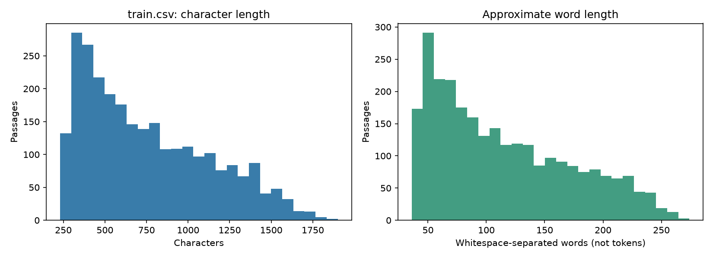
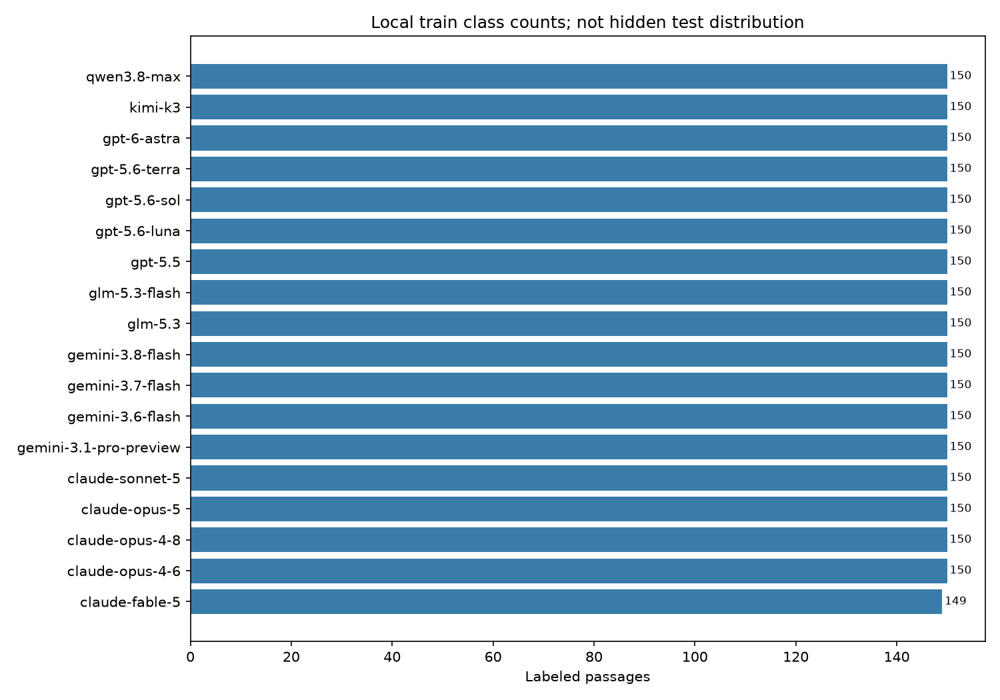

# Tổng quan dữ liệu Name That LLM

Ngày kiểm tra: **26/10/2026**, múi giờ Asia/Saigon. Workspace: `C:\Users\Khoa Bi\VS Studio\repos\name-that-llm`.

## Kết luận trước khi xây mô hình

**Có thể chuẩn bị baseline CPU từ dữ liệu hiện có:** train thực tế có **2.699 dòng gán nhãn, 18 model và 150 prompt**. Test công khai chỉ có **3 dòng không nhãn**; không dùng ba dòng này để suy ra hidden test hay đánh giá độ chính xác. `sample_submission.parquet` là mẫu định dạng, không phải đáp án test. Chưa huấn luyện hoặc chạy inference nào.

Nguồn gốc ba bản local **chưa được chứng thực bằng checksum từ Kaggle**. Tên, schema, số dòng và dung lượng phù hợp mô tả chính thức; điều đó chưa chứng minh file hoàn toàn giống bản tải chính thức. Không có manifest tải về hoặc lịch sử nguồn trong workspace.

## 1. Phạm vi, hướng dẫn và nguồn

Không tìm thấy README, AGENTS.md, code phân tích có sẵn hoặc quy ước thư mục dự án trong workspace; đã kiểm tra AGENTS.md ở các thư mục cha đến `C:\`. Workspace không phải Git repository (`git status` báo lỗi tương ứng). Chỉ đọc ba file dữ liệu liên quan và tạo tài liệu/script mới. Không đọc credential, `.env`, `kaggle.json`, PDF/DOCX không liên quan; không sửa dữ liệu gốc, commit, push, dùng GPU, gọi API AI hay gửi submission.

### Đã xác minh từ nguồn chính thức

Đọc trực tiếp nội dung hiển thị trong trình duyệt Kaggle, không chỉ dựa vào kết quả tìm kiếm. Công cụ web ban đầu trả trang không có nội dung; trang Data qua tìm kiếm cũng thiếu phần mô tả. Nội dung trình duyệt là nguồn cho các chi tiết bên dưới.

| Nguồn | Mục đã đọc | Kết quả |
|---|---|---|
| [Overview](https://www.kaggle.com/competitions/name-that-llm/overview) | Description | Nhận diện model sinh một đoạn văn; 18 ứng viên; khoảng 4.000 đoạn hidden test; chủ đề đa dạng. |
| [Data](https://www.kaggle.com/competitions/name-that-llm/data) | Dataset Description → Files, Columns | Có train chính thức 2.699 đoạn/150 prompt; test mẫu 3 dòng; prompt test không xuất hiện trong train; mô tả schema từng file. |
| [Evaluation](https://www.kaggle.com/competitions/name-that-llm/overview#evaluation) | Evaluation, Valid Labels, Submission File | Balanced accuracy, 18 tên model hợp lệ, hai cột `id, model`, lưu `submission.parquet`. |
| [Code Requirements](https://www.kaggle.com/competitions/name-that-llm/overview#code-requirements) | Code Requirements và ví dụ Submission File | Nộp qua Notebook; CPU ≤9 giờ hoặc GPU ≤9 giờ; Internet tắt; cho phép dữ liệu ngoài công khai miễn phí, gồm model tiền huấn luyện. |
| [Rules](https://www.kaggle.com/competitions/name-that-llm/rules) | Competition-Specific Rules §2.6 External Data and Tools | Dữ liệu ngoài phải công khai và tiếp cận bình đẳng miễn phí, hoặc đáp ứng điều kiện Reasonableness về khả năng tiếp cận/chi phí. Không phải mọi API trả phí đều mặc nhiên được phép. |
| [Rules](https://www.kaggle.com/competitions/name-that-llm/rules) | Foundational Rules → Competition Entry; Competition-Specific Rules → Data Security | Không dùng nhãn thủ công/dự đoán của con người trên validation/test trong submission; chú ý hạn chế chia sẻ dữ liệu ngoài người tham dự. Báo cáo và trích mẫu này chỉ lưu local. |

Các trang [FAQ Notebook](https://www.kaggle.com/docs/competitions#notebooks-only-FAQ) và [debugging](https://www.kaggle.com/code-competition-debugging) được Overview liên kết, nhưng công cụ web không đọc được nội dung: **chưa xác minh chi tiết bổ sung từ hai trang này**. Đã đọc hướng dẫn submission tối thiểu do BTC đặt ngay trong Overview. Chưa xác minh có notebook khởi đầu riêng do BTC cung cấp; không xem notebook cộng đồng là tài liệu chính thức.

### Input, target, metric và submission

- **Input:** `text`, đoạn văn do LLM sinh; `id` là định danh. `prompt_id` là metadata nhóm trong train, không có trong test.
- **Target:** `model`, một trong 18 tên ở bảng thống kê lớp bên dưới. Đây là phân loại nhiều lớp (mỗi đoạn có một tác giả model), không phải phân biệt người với AI.
- **Balanced accuracy:** tính recall của mỗi lớp rồi lấy trung bình của 18 lớp. Recall là số đoạn nhận diện đúng trong lớp chia tổng đoạn thật sự thuộc lớp đó. Mỗi lớp có trọng số bằng nhau, dù số đoạn khác nhau. BTC công bố lớp test không đều và tỷ trọng public/private leaderboard khác nhau. Nguồn: Evaluation.
- **Định dạng:** Parquet với thứ tự cột minh họa và file mẫu thực tế là `id`, `model`; `model` là chuỗi tên model, không phải 18 cột xác suất. Không có thứ tự 18 cột nhãn cần khớp. Nếu nội bộ dùng mã số lớp, phải ánh xạ ngược đúng chuỗi.
- Mỗi ID test xuất hiện đúng một lần; không null, không lặp ID, không nhãn ngoài danh sách. Notebook đọc `/kaggle/input/competitions/name-that-llm/test.csv`, ghi `submission.parquet` vào working directory. Ví dụ CSV trong mô tả chỉ minh họa bảng; file thực tế yêu cầu là Parquet. Nguồn: Submission File.

**Điểm không nhất quán chính thức:** Overview → Submission File ghi test tương tác có **1 dòng**, Data → Files ghi **3 dòng**; file local đo được **3 dòng**. Không tự chọn một con số để áp dụng mọi phiên bản. Hidden rerun được mô tả khoảng 4.000 đoạn, chưa truy cập được file hidden, không biết số dòng chính xác. Public leaderboard cũng không đồng nghĩa với ba mẫu test tải được.

**Giới hạn thực thi:** xác minh được giới hạn 9 giờ cho từng loại CPU/GPU Notebook và Internet tắt, chưa xác minh số core, RAM hoặc loại GPU cụ thể. Do Internet tắt, không thể dựa vào gọi dịch vụ/API online trong lượt chấm. Quyền dùng API để tạo dữ liệu ngoài trước lượt chấm, điều kiện chia sẻ và chi phí cụ thể **chưa được xác minh riêng cho từng dịch vụ**; cần đối chiếu Rules/giải đáp BTC trước khi thực hiện. Công việc hiện tại không gọi các dịch vụ đó. Nguồn: Code Requirements và Rules §2.6.

## 2. Đã đo từ file thực tế: kiểm kê và nguồn gốc

Đọc **toàn bộ** ba file, không lấy mẫu cho thống kê; chỉ rút gọn phần hiển thị ví dụ. Tổng dung lượng **2.142.535 byte** (~2,14 MB thập phân). Không có nhiều bản cùng tên hoặc file trùng SHA-256 trong phạm vi workspace đã quét. Không tìm dữ liệu ở toàn bộ ổ đĩa hay thư mục không liên quan.

| File, đường dẫn tương đối workspace | Nguồn/vai trò | Byte | Số dòng | Số cột | Ghi chú |
|---|---|---:|---:|---:|---|
| `train.csv` | Local, phù hợp train chính thức; chưa chứng thực checksum nguồn | 2.139.418 | 2.699 | 4 | Có nhãn `model`, có `prompt_id` |
| `test.csv` | Local, phù hợp test mẫu công khai | 2.218 | 3 | 2 | Không có nhãn; không phải toàn bộ hidden test |
| `sample_submission.parquet` | Local, mẫu định dạng | 899 | 3 | 2 | Cả ba giá trị `model` là `gpt-5.5`, không phải ground truth |

| File | SHA-256 đo local |
|---|---|
| train.csv | `40a22ce8d88c5f46feb4637a099db815bef5f713ffe53e89dbe1b7b21de77707` |
| test.csv | `4545aa3a3459f4c0724f97ad5bd06c4caa3506bdfea5fab905e8203184fc0c57` |
| sample_submission.parquet | `ccf86796b80fd7f83d8463664603fd1208e17559abcf416f198776b819646188` |

Đã có dữ liệu nên không tải lại, không cần kiểm tra xác thực Kaggle. Không có Kaggle CLI trên PATH hoặc package `kaggle` trong Python đã kiểm tra. Trình duyệt chưa đăng nhập, Data Explorer yêu cầu đăng nhập/đồng ý điều khoản để xem/tải; không thực hiện các bước đó. Không tải dataset cộng đồng, model weights hoặc tự tạo dữ liệu. Tài liệu/script và số liệu tổng hợp mới tạo là **sản phẩm phân tích**, không phải dữ liệu train mới.

**Danh mục đầy đủ dùng cho kết quả cuối:** [name_that_llm_data_inventory_1.csv](name_that_llm_data_inventory_1.csv). File không hậu tố là lần chạy đầu thiếu engine Parquet; được giữ lại theo yêu cầu không ghi đè. [name_that_llm_data_statistics_1.json](name_that_llm_data_statistics_1.json) là số liệu máy đọc của lần chạy thành công cả ba file, `errors=[]`.

## 3. Schema, tính đầy đủ và quan hệ

Ý nghĩa cột dưới đây đã đối chiếu Data → Columns. CSV được đọc rõ kiểu chuỗi để giữ nguyên ID; CSV vốn không lưu kiểu dữ liệu chặt như Parquet.

| Bảng | Cột | Kiểu đọc | Ý nghĩa | Thiếu | Số giá trị duy nhất, bỏ null |
|---|---|---|---|---:|---:|
| train | id | string | ID ẩn danh của đoạn | 0 | 2.699 |
| train | prompt_id | string | ID ẩn danh prompt được trả lời | 0 | 150 |
| train | text | string | Đoạn văn model sinh | 0 | 2.699 |
| train | model | string | Nhãn model thật | 0 | 18 |
| test | id | string | ID đoạn | 0 | 3 |
| test | text | string | Đoạn cần phân loại | 0 | 3 |
| sample_submission | id | str | ID tương ứng test | 0 | 3 |
| sample_submission | model | str | Nhãn dự đoán minh họa | 0 | 1 |

Không ID null/rỗng/chỉ khoảng trắng hoặc trùng ở cả ba bảng. Tập ID của sample bằng chính xác tập ID test; train không giao ID với hai bảng còn lại. Không cột prompt nguyên văn hay metadata source/chủ đề/ngôn ngữ; chỉ train có `prompt_id`. Không tự tái dựng prompt hoặc gán nhãn test.

Có 149 prompt với 18 dòng và 1 prompt với 17 dòng. Không trùng cặp `(prompt_id, model)`. Prompt **p002 thiếu claude-fable-5** so với tích Descartes 150×18; chưa biết nguyên nhân, không tự điền dòng thiếu.

### Ví dụ dữ liệu (ba dòng đầu theo thứ tự file; text rút ngắn)

| train.id | prompt_id | text rút gọn | model |
|---|---|---|---|
| 0018b3765972 | p081 | When a language dies, a particular astronomy dims… | qwen3.8-max |
| 0041ac86ee93 | p073 | Data science communities matter because they accelerate learning… | claude-sonnet-5 |
| 005a19083eae | p120 | In the final twilight of time, the last embers of ancient suns… | gemini-3.6-flash |

| test.id | text rút gọn |
|---|---|
| 00353fb1c541 | The more efficiently we use a resource, the more of it we ultimately consume… |
| 005f5a9a6139 | The Stern-Gerlach experiment, performed in 1922 by Otto Stern and Walther Gerlach… |
| 0062a53d5487 | Hundreds of millions of years ago, fluctuating climates and tectonic shifts… |

| sample_submission.id | model minh họa |
|---|---|
| 00353fb1c541 | gpt-5.5 |
| 005f5a9a6139 | gpt-5.5 |
| 0062a53d5487 | gpt-5.5 |

## 4. EDA văn bản bằng CPU

EDA là phân tích khám phá dữ liệu trước khi xây mô hình. Độ dài ký tự dùng Python `len`, tức số Unicode code point; không phải số byte hay số ký tự nhìn thấy trong mọi trường hợp. Số từ dùng `str.split()` theo khoảng trắng, **không phải số token của tokenizer LLM**. p90/p95 là ngưỡng mà khoảng 90%/95% mẫu không vượt quá, dùng nội suy tuyến tính của pandas.

### Văn bản thiếu và độ dài

Không có text null, rỗng hoặc chỉ khoảng trắng trong train/test. Quy ước parser CSV: ô trống được coi là missing; chuỗi `NA`, `null` viết bằng chữ được giữ nguyên, không tự suy thành null. CSV không biểu diễn null chặt chẽ, nên kiểm tra missing cần hiểu theo quy ước này.

| File / đại lượng | Min | Median | Mean | p90 | p95 | Max |
|---|---:|---:|---:|---:|---:|---:|
| Train: ký tự | 230 | 670 | 755,29 | 1.326,20 | 1.469,20 | 1.900 |
| Train: từ gần đúng | 36 | 101 | 114,66 | 206 | 224 | 274 |
| Test mẫu: ký tự | 321 | 760 | 719,33 | 1.013,60 | 1.045,30 | 1.077 |
| Test mẫu: từ gần đúng | 48 | 111 | 102,67 | 141,40 | 145,20 | 149 |

Description nói đoạn dài ngẫu nhiên 40–250 từ; cách đếm khoảng trắng của chúng ta đo 36–274 ở train. Đây là khác biệt cần ghi nhận, chưa đủ kết luận dữ liệu sai: chưa biết quy trình đếm từ của BTC. Không loại ngoại lệ hoặc cắt văn bản chỉ dựa vào mô tả đó.



Không vẽ phân bố test với n=3. Các percentile test vẫn được tính để đầy đủ nhưng rất không ổn định, không đại diện hidden test.

### Lớp và độ dài theo lớp

Tên nhãn đối chiếu Evaluation → Valid Labels: không nhãn lạ hoặc thiếu lớp trong train. OpenAI gồm 5 nhãn GPT; Google gồm 4 nhãn Gemini; Anthropic gồm 5 nhãn Claude; Qwen: qwen3.8-max; ZAI: glm-5.3 và glm-5.3-flash; Moonshot AI: kimi-k3.

| Model | Dòng | Ký tự median | Ký tự mean | Từ median | Từ mean |
|---|---:|---:|---:|---:|---:|
| claude-fable-5 | 149 | 646 | 731,02 | 100 | 112,50 |
| claude-opus-4-6 | 150 | 687,5 | 771,21 | 98,5 | 115,15 |
| claude-opus-4-8 | 150 | 731,5 | 809,81 | 109 | 123,59 |
| claude-opus-5 | 150 | 725,5 | 762,81 | 116,5 | 123,44 |
| claude-sonnet-5 | 150 | 707 | 816,58 | 99,5 | 120,05 |
| gemini-3.1-pro-preview | 150 | 714 | 782,97 | 104 | 119,35 |
| gemini-3.6-flash | 150 | 634,5 | 758,56 | 95,5 | 111,15 |
| gemini-3.7-flash | 150 | 717,5 | 828,69 | 101,5 | 117,11 |
| gemini-3.8-flash | 150 | 583 | 706,20 | 84 | 100,68 |
| glm-5.3 | 150 | 616,5 | 710,27 | 96 | 110,34 |
| glm-5.3-flash | 150 | 744 | 777,60 | 112 | 119,17 |
| gpt-5.5 | 150 | 643,5 | 698,65 | 103,5 | 110,27 |
| gpt-5.6-luna | 150 | 673 | 766,63 | 104,5 | 115,39 |
| gpt-5.6-sol | 150 | 747,5 | 779,35 | 111,5 | 118,93 |
| gpt-5.6-terra | 150 | 648,5 | 746,58 | 100,5 | 113,26 |
| gpt-6-astra | 150 | 677,5 | 750,25 | 105,5 | 117,77 |
| kimi-k3 | 150 | 594,5 | 690,13 | 89 | 107,37 |
| qwen3.8-max | 150 | 625 | 707,73 | 98,5 | 108,35 |

Min/p90/p95/max theo từng lớp của cả hai đại lượng được lưu đầy đủ trong JSON cuối → `files` → train → `classes`. Train gần cân bằng không có nghĩa test cân bằng; BTC đã nói test không đều.



### Duplicate và dấu hiệu hình thức

Duplicate là nội dung lặp; leakage là thông tin bị lọt từ phần đánh giá vào quá trình học/chọn mô hình. Trong mỗi file text: **0 nhóm trùng nguyên văn**, **0 nhóm trùng sau NFC + gộp khoảng trắng**; số dòng dư do trùng đều 0. Giữa train và test mẫu: 0 nội dung giao nhau theo cả hai cách. Trong train: 0 nhóm text trùng nhưng khác nhãn theo cả hai cách.

Chuẩn hóa chỉ trên bản sao trong bộ nhớ, không lowercase hay bỏ dấu câu, không sửa file. NFC ghép các biểu diễn Unicode tương đương; gộp khoảng trắng có thể làm mất dấu hiệu phong cách. Không mặc định dùng bản chuẩn hóa làm input mô hình. **Chưa kiểm tra near-duplicate bằng độ tương đồng nội dung**; không có duplicate chính xác không chứng minh hết rò rỉ.

| Heuristic: số đoạn có ít nhất một dấu hiệu | Train / 2.699 | Test / 3 |
|---|---:|---:|
| Markdown: heading/bold/link | 0 | 0 |
| Code fence ba backtick hoặc ba dấu ~ | 0 | 0 |
| Bullet hoặc danh sách đánh số ở đầu dòng | 0 | 0 |
| URL http(s)/www | 0 | 0 |
| Ký tự ngoài ASCII | 1.561 (57,84%) | 1 |
| Ngoặc kép/nháy cong “ ” ‘ ’ | 607 (22,49%) | 1 |
| Em dash — | 1.052 (38,98%) | 0 |
| Cụm tiếng Anh có thể là từ chối | 10 (0,37%) | 0 |
| Nhắc tên họ model | 18 (0,67%) | 0 |
| Cấu trúc tiếng Anh có thể tự xưng tên model | 0 | 0 |

Heuristic là quy tắc gần đúng, không phải nhãn chuẩn. Regex nằm trong script và JSON. Các phép đo chỉ tìm những mẫu đã định nghĩa: Markdown chưa bao phủ inline code, bảng hoặc italic; tên model nhắc tới có thể chỉ là chủ đề; câu “I cannot” có thể là lời kể/khẳng định khả năng chứ không từ chối. Tự xưng tên không khớp regex vẫn có thể tồn tại dưới cách diễn đạt khác. Không dùng 18 trường hợp nhắc tên làm nhãn mới.

Chưa có bộ nhận diện ngôn ngữ/chủ đề được kiểm định, nên **không gán nhãn tự động và không báo tỷ lệ ngôn ngữ/chủ đề toàn tập**. Ba ví dụ test trích dẫn là tiếng Anh về tài nguyên, vật lý và địa chất theo đọc thủ công; đây chỉ là mô tả ba mẫu, không nhãn train hoặc suy luận phân bố hidden. Ngoài ASCII có thể chỉ do dấu câu; không dùng nó làm bộ nhận diện ngôn ngữ.

## 5. Nhận định/giả thuyết cần kiểm chứng và validation

| Rủi ro | Bằng chứng/giới hạn | Hướng xử lý đề xuất, chưa chạy |
|---|---|---|
| Thiếu train gán nhãn | Không xảy ra ở snapshot này: có 2.699 nhãn. Nhưng chỉ 149–150 mẫu/lớp và 150 prompt | Đánh giá độ biến thiên giữa fold; tránh coi số dòng là số tình huống độc lập |
| Cùng prompt lọt qua hai phía | 149 prompt có đủ 18 model, p002 có 17; Data nói prompt test mới | Chia nhóm theo `prompt_id` có metadata thực, giữ mỗi prompt hoàn toàn trong một fold |
| Cùng chủ đề ở các prompt khác nhau | Không có nhãn chủ đề hoặc prompt nguyên văn | Group theo prompt không bảo đảm tách chủ đề; chưa đủ metadata để tuyên bố validation theo chủ đề/source |
| Duplicate/near-duplicate | Không trùng chính xác/NFC+whitespace; chưa đo near-duplicate | Kiểm tra tương đồng character/word shingles giữa prompt trước khi chốt split, kiểm duyệt các cặp nghi ngờ |
| Học tên model/template/chủ đề thay vì phong cách | 18 đoạn nhắc họ model; có dấu câu và độ dài khác nhau; chưa đo tác dụng dự đoán | So sánh có/không đặc trưng tên model, dấu câu, độ dài bằng validation train; không suy ra causal signal từ EDA |
| Dữ liệu tự thu thập lệch dữ liệu chấm | Chưa có dữ liệu ngoài; cách sinh/temperature/system prompt chưa biết | Nếu sau này bổ sung, lưu provenance, phiên bản model và cấu hình; kiểm tra chuyển miền trên tập giữ riêng |
| Sai nhãn/thứ tự cột | Mẫu có `id,model`; 18 chuỗi phải chính xác | Kiểm tra schema và tập ID động; mã hóa/giải mã lớp nhất quán, không dựa vào thứ tự hàng |
| Đánh giá sai từ test mẫu/public LB | Test tải được chỉ 3 dòng và không nhãn; hidden khoảng 4.000; public/private khác tỷ trọng | Không dùng test hoặc leaderboard để chọn siêu tham số; dựa vào holdout/CV của train |

**Validation đề xuất:** cố định trước 5 fold theo `prompt_id` (GroupKFold hoặc StratifiedGroupKFold nếu cần kiểm tra phân bố lớp), khoảng 30 prompt/fold. Không để ID prompt xuất hiện ở cả train và validation. Kiểm tra mọi fold có đủ 18 lớp, không giao prompt/text; fit TF-IDF chỉ trên phần train của từng fold. Báo balanced accuracy trung bình/độ lệch giữa fold và recall từng lớp. Chưa tạo split hoặc chạy mô hình trong nhiệm vụ này. Không dùng `prompt_id` làm đặc trưng dự đoán vì test không có cột đó.

Nếu sau này phát hiện cụm near-duplicate nằm ở nhiều prompt, cần gom nhóm bổ sung rồi tạo lại quy trình đánh giá trước khi tuning. Dữ liệu thiếu metadata source nên chưa thể đề xuất group split theo source với bằng chứng. Không thể kiểm tra overlap với hidden test.

## 6. Tái lập, thư viện và lỗi đã xử lý

Script: [inspect_name_that_llm_data.py](../scripts/inspect_name_that_llm_data.py). Chỉ đọc các basename CSV/Parquet được chỉ định trong `--data-dir`, mặc định ba file cuộc thi, quét đệ quy để nhận biết nhiều bản; không đọc pickle, không thực thi dữ liệu. Toàn bộ dòng được đọc vào bộ nhớ: phù hợp snapshot nhỏ này, chưa bảo đảm phù hợp file hàng GB. File đầu ra dùng tên hậu tố tăng dần khi đã tồn tại.

Lệnh chuẩn trên môi trường đã cài pandas, pyarrow và matplotlib:

```powershell
python scripts/inspect_name_that_llm_data.py --data-dir . --output-dir reports
```

Python launcher của máy không có Python thông thường (`py -0p`: No installed Pythons found), nên đã dùng runtime đi kèm Codex. Lần đầu thiếu pyarrow/matplotlib; tải từ PyPI ban đầu lỗi DNS trong sandbox. Cài thư viện vào thư mục tạm bằng quyền mạng được chấp thuận; không cài vào code/dữ liệu dự án. Thư mục TEMP ở tiến trình sandbox khác tiến trình cài thư viện, nên PYTHONPATH ban đầu không hiệu lực; đã truyền đường dẫn rõ ràng bằng `sys.path.insert`. Lần chạy cuối thành công **3/3 file**, `errors=[]`.

Lệnh cuối thực tế đã chạy từ workspace (PowerShell):

```powershell
$env:MPLCONFIGDIR = "$env:TEMP\name_that_llm_matplotlib"
& 'C:\Users\Khoa Bi\.cache\codex-runtimes\codex-primary-runtime\dependencies\python\python.exe' -c "import sys,runpy; sys.path.insert(0,r'C:\Users\KHOABI~1\AppData\Local\Temp\name_that_llm_analysis_deps'); sys.argv=['scripts/inspect_name_that_llm_data.py','--data-dir','.','--output-dir','reports']; runpy.run_path(sys.argv[0],run_name='__main__')"
```

Phiên bản lần cuối: **Python 3.12.14; pandas 3.0.1; numpy 2.5.4; pyarrow 26.0.0; matplotlib 3.11.2**. Các dependency ở TEMP có thể không còn ở phiên làm việc sau; khi đó dùng môi trường Python của bạn với các thư viện tương ứng. Matplotlib dùng backend Agg bằng CPU.

Đầu ra lần đầu không hậu tố ghi nhận lỗi dependency, không phải kết quả hoàn chỉnh. Lần cuối tạo inventory/statistics hậu tố `_1` và hai biểu đồ PNG. Không có dữ liệu gốc/weights được thêm vào Git; workspace hiện không có Git repository. SHA-256 đầu vào đã đối chiếu sau phân tích để kiểm tra dữ liệu không đổi.

## 7. Trả lời trực tiếp và ba bước tiếp theo

1. **Hiện có gì?** Ba file local phù hợp gói công khai: train 2.699 dòng, test mẫu 3 dòng, mẫu submission 3 dòng; không có hidden test hoặc dữ liệu ngoài.
2. **Dữ liệu nào có nhãn?** Chỉ `train.model` là ground truth. `sample_submission.model` chỉ minh họa. Test không nhãn.
3. **Xây baseline ngay được chưa?** Có thể lên quy trình và huấn luyện baseline CPU nhẹ sau nhiệm vụ này; dữ liệu train có đủ 18 lớp. Trước hết cần cố định validation theo prompt và xác nhận provenance nếu chưa chắc bản local. Không có kết quả baseline hoặc điểm CV trong báo cáo này.
4. **Biết/chưa biết?** Đã xác minh schema, nhãn, metric và quy định chính từ Kaggle; đã đo đầy đủ ba file local. Chưa xác minh checksum chính thức, chi tiết dịch vụ API ngoài, cấu hình phần cứng cụ thể, near-duplicate, cơ chế sinh dữ liệu và phân bố hidden. Hai mô tả số dòng test công khai còn không nhất quán.

**Ba bước nên làm tiếp:**

1. Xác nhận lịch sử tải ba file hoặc đối chiếu với gói Kaggle chính thức khi bạn đã có quyền truy cập. Nếu cần: tự đăng nhập, đọc/đồng ý Rules nếu phù hợp, tải ba file từ Data vào thư mục mới rồi chạy script với đường dẫn đó; không ghi đè bản đang có. Không bắt buộc tải lại để sử dụng báo cáo hiện tại. Đọc lại Rules §2.6/giải đáp BTC trước mọi kế hoạch dùng API tạo dữ liệu.
2. Thiết kế validation 5 fold theo `prompt_id`, kiểm tra near-duplicate và độ phủ 18 lớp, khóa quy trình trước tuning. Giữ test mẫu chỉ để kiểm tra khả năng đọc schema về sau.
3. Khi được yêu cầu ở bước mô hình hóa, thử **TF-IDF character n-gram + Logistic Regression hoặc Linear SVM trên CPU**, fit riêng trong từng fold, đo balanced accuracy/recall lớp. TF-IDF biểu diễn mức đặc trưng của cụm ký tự/từ; classifier tuyến tính học trọng số để chọn lớp. Sau đó mới cân nhắc bổ sung đặc trưng phong cách và kiểm tra từng thay đổi trên cùng validation. Chưa triển khai, train hoặc inference trong công việc này.
